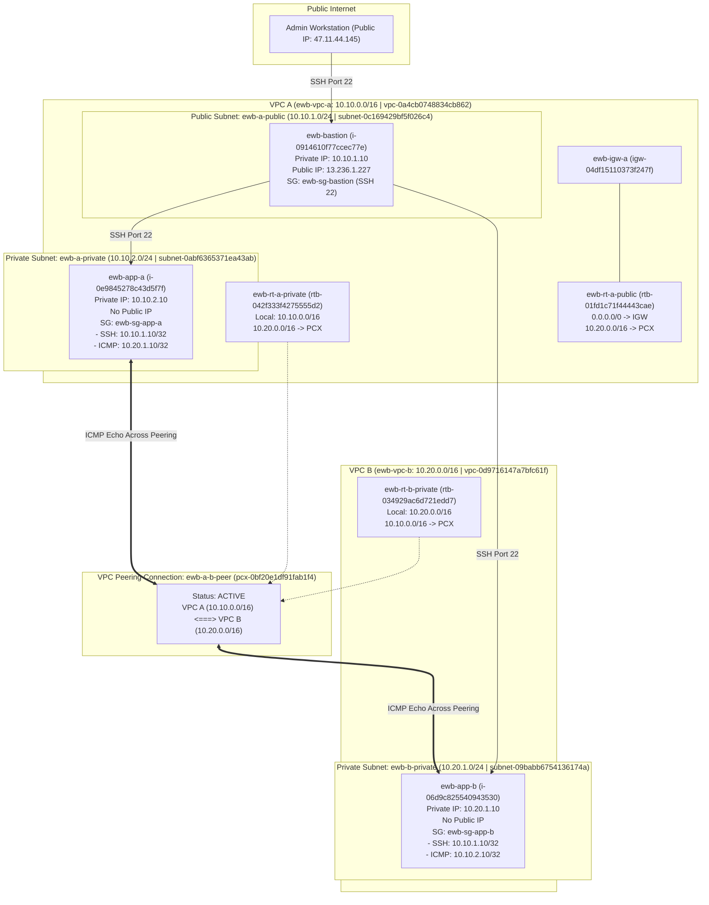

# EWB VPC Peering Automation (Python & Boto3)

Enterprise-grade automated provisioning, routing, security grouping, and architectural testing for the **EWB VPC Peering Project** using Python and Boto3.

---

## 🏛 Architecture Overview



---

## 📋 Active Provisioned Resources Summary

| Resource Type | Resource Name | AWS Resource ID / Details |
| :--- | :--- | :--- |
| **Region** | `ap-southeast-2` (Sydney) | Allowed by AWS Organization SCP `p-ukp3edi2` |
| **VPC A** | `ewb-vpc-a` | `vpc-0a4cb0748834cb862` (CIDR: `10.10.0.0/16`) |
| **VPC B** | `ewb-vpc-b` | `vpc-0d9716147a7bfc61f` (CIDR: `10.20.0.0/16`) |
| **Subnet (Public)** | `ewb-a-public` | `subnet-0c169429bf5f026c4` (CIDR: `10.10.1.0/24`) |
| **Subnet (Private)** | `ewb-a-private` | `subnet-0abf6365371ea43ab` (CIDR: `10.10.2.0/24`) |
| **Subnet (Private)** | `ewb-b-private` | `subnet-09babb6754136174a` (CIDR: `10.20.1.0/24`) |
| **Internet Gateway** | `ewb-igw-a` | `igw-04df15110373f247f` attached to `ewb-vpc-a` |
| **Route Table A Pub** | `ewb-rt-a-public` | `rtb-01fd1c71f44443cae` (`0.0.0.0/0` -> IGW, `10.20.0.0/16` -> PCX) |
| **Route Table A Priv**| `ewb-rt-a-private` | `rtb-042f333f4275555d2` (`10.20.0.0/16` -> PCX) |
| **Route Table B Priv**| `ewb-rt-b-private` | `rtb-034929ac6d721edd7` (`10.10.0.0/16` -> PCX) |
| **VPC Peering** | `ewb-a-b-peer` | `pcx-0bf20e1df91fab1f4` (**ACTIVE**) |
| **Security Group** | `ewb-sg-bastion` | `sg-0692ebdaae91c62ef` (SSH from admin IP) |
| **Security Group** | `ewb-sg-app-a` | `sg-0dd66beea5cc3c12d` (SSH from `10.10.1.10/32`, ICMP from `10.20.1.10/32`) |
| **Security Group** | `ewb-sg-app-b` | `sg-010a3c67752a85558` (SSH from `10.10.1.10/32`, ICMP from `10.10.2.10/32`) |
| **Compute Instance** | `ewb-bastion` | `i-0914610f77ccec77e` (Private IP: `10.10.1.10`, Public IP: `13.236.1.227`) |
| **Compute Instance** | `ewb-app-a` | `i-0e9845278c43d5f7f` (Private IP: `10.10.2.10`, No Public IP) |
| **Compute Instance** | `ewb-app-b` | `i-06d9c825540943530` (Private IP: `10.20.1.10`, No Public IP) |

---

## 🚀 Execution & Verification Commands

### 1. Re-run Automated Deployment (Idempotent)
```bash
python deploy.py
```
Safely re-evaluates all resources. Existing resources are preserved without error or duplicate creation.

---

### 2. Run Automated Verification Audit
```bash
python verify.py
```
Checks every single architectural constraint against live AWS state and outputs a comprehensive PASS/FAIL report.

---

### 3. End-to-End Connectivity Testing

#### Step 3.1: Connect to Bastion Host
```bash
ssh -i ewb-lab.pem ec2-user@13.236.1.227
```

#### Step 3.2: SSH Jump from Bastion to `ewb-app-a`
```bash
ssh -i ewb-lab.pem -J ec2-user@13.236.1.227 ec2-user@10.10.2.10
```

#### Step 3.3: Ping `ewb-app-b` across VPC Peering Connection
From inside `ewb-app-a` (`10.10.2.10`):
```bash
ping -c 4 10.20.1.10
```
*(ICMP Echo Request traverses `ewb-rt-a-private` -> `pcx-0bf20e1df91fab1f4` -> `ewb-vpc-b` -> `ewb-app-b`)*.

---

### 4. Teardown / Deprovisioning
When done with testing, cleanly delete all resources:
```bash
python destroy.py
```
